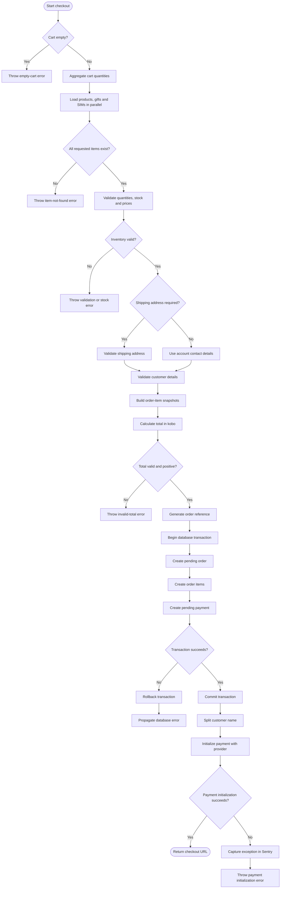

# Checkout Flow

This document describes the checkout process implemented by `CheckoutService`, from cart validation to payment initialization.

## Overview

## 1. Validate the cart

1. Reject an empty cart.
2. Aggregate duplicate cart entries by item type and ID.
3. Load products, gifts, and SIMs concurrently using their respective repositories.
4. Verify that every requested item exists.
5. Validate quantities, inventory stock, and prices.

Checkout stops if an item is missing, a quantity is invalid, stock is unavailable or insufficient, or a price is invalid.

## 2. Validate customer and shipping details

A shipping address is required when the cart contains gifts or physical SIMs.

- **Physical checkout:** Parse and validate the shipping details using `createPhysicalCheckoutSchema`. Use the submitted full name and phone number.
- **Other checkouts:** Use the customer's account full name and phone number.

The full name must not be empty.

## 3. Build order items and calculate the total

Build order-item snapshots for each item type:

- **Product:** Product relationship, name, image, unit price, quantity, and line total.
- **Gift:** Gift relationship, name, image, unit price, quantity, and line total.
- **SIM:** SIM relationship, name, image, unit price, quantity, line total, and SIM type.

The line total is calculated as:

`lineTotal = unitPrice × quantity`

The checkout total is the sum of all line totals, represented in kobo. The total must be a positive safe integer.

## 4. Persist the order and payment

Generate an order reference, then execute the database writes inside a single transaction.

1. Create the order with `ORDER_STATUS.PENDING`.
2. Create each order item with `ORDER_FULFILLMENT_STATUS.PENDING`.
3. Create the payment with `PAYMENT_STATUS.PENDING`.

If a database operation fails, the transaction should roll back. If it succeeds, the transaction commits and returns the created order and payment records.

## 5. Initialize the external payment

After the database transaction commits:

1. Split the customer's full name into first and last names.
2. Prepare the payment initialization request with the amount, currency, customer details, order reference, and redirect URL.
3. Call `paymentService.initializePayment()` using the persisted payment ID.
4. Return the provider's checkout URL when initialization succeeds.

If payment initialization fails, the service captures the exception in Sentry with the order ID, payment ID, reference, and flow metadata, then throws a payment initialization error.

## Failure handling

| Failure | Result |
|---|---|
| Empty cart | Checkout throws an error before loading inventory. |
| Missing item | Checkout throws an item-not-found error. |
| Invalid quantity, stock, or price | Checkout throws a validation or inventory error. |
| Invalid shipping details | Schema validation fails. |
| Invalid checkout total | Checkout throws an error before creating the order. |
| Database write fails | Transaction rollback is expected. |
| Payment initialization fails | Error is captured in Sentry; the committed pending order and payment remain persisted. |

## Important considerations

### Payment initialization is outside the transaction

The database transaction commits before the external payment provider is called. Consequently, a payment initialization failure does not automatically remove the order or payment records.

The application should provide a recovery strategy for these pending records, such as retrying payment initialization or reconciling their state.

### Stock is checked but not reserved

Inventory validation checks the available stock before the order is created. It does not atomically reserve or decrement stock. Concurrent checkouts may therefore oversell inventory unless stock reservation is handled elsewhere.

### Payment status is not final at checkout

Creating a pending payment and obtaining a checkout URL does not mean the payment has succeeded. The final payment and order state should be determined by the application's verified payment-processing flow.
